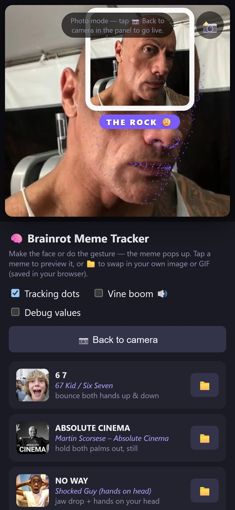

# 🧠 Brainrot Meme Face Tracker

### ▶️ [Try it online](https://isaraapae.github.io/meme-face-tracker/)

Make the face or do the gesture, and the matching meme pops up over your head.
It runs entirely in your browser: the camera never leaves your device.



## Features

- **17 memes**, each set off by a face, a hand gesture, or both ([full list](meme-face-tracker/README.md#the-memes))
- **📸 Snapshot**: save a picture of you with the meme
- **📁 Your own memes**: swap in any image or GIF (kept in your browser)
- **🖼 No camera?** Run the tracker on a photo instead
- **Keyboard and screen-reader friendly**: Tab to any meme and press Enter to preview it
- **Works offline**: the AI models are bundled, and nothing is uploaded anywhere

## What you need

- A recent browser with a camera, on a computer or a phone
- The page opened over `https://` or from `localhost`, since browsers only allow the camera there (the online version and the start scripts both do this)
- About 12 MB of download the first time (the tracking models); after that it's cached

## Run it offline

1. [Download the ZIP](https://github.com/IsaraApae/meme-face-tracker/archive/refs/heads/main.zip) and unzip it.
2. Open the `meme-face-tracker` folder inside and double-click `start.command` (Mac) or `start.bat` (Windows).
   See [its README](meme-face-tracker/README.md) if that doesn't work.

Or from a terminal:

```bash
git clone https://github.com/IsaraApae/meme-face-tracker.git
cd meme-face-tracker/meme-face-tracker
python3 -m http.server 8765
```

Then open http://localhost:8765.

## How it works

Plain HTML, CSS and JavaScript in one file, [`index.html`](meme-face-tracker/index.html): no build step and nothing to install.

- [MediaPipe](https://ai.google.dev/edge/mediapipe/solutions/vision/face_landmarker) (by Google) tracks 478 points on your face plus 52 expression scores, and both hands with their gesture, on every camera frame.
- Each meme has a small scoring function over those values. The best match above its threshold, held for a few frames, pops up.
- The library and models live in [`meme-face-tracker/vendor`](meme-face-tracker/vendor), so it works offline. If that folder is missing, it loads them from the web instead.

## Developing

- Turn on **Debug values** in the sidebar to see the live scores while tuning a meme.
- Add `?photo=memes/rock.webp` to the URL to run the tracker on a picture instead of the camera.
- The **Check** workflow validates the HTML and checks that every meme has its image, on every push and pull request.
- Every push to `main` publishes the `meme-face-tracker` folder to GitHub Pages ([`pages.yml`](.github/workflows/pages.yml)).
- No environment variables or API keys are needed.

## License

The code is [MIT](LICENSE). The meme images in `meme-face-tracker/memes` belong to their respective owners and aren't covered by that license.
MediaPipe and its models are by Google, under the [Apache License 2.0](meme-face-tracker/vendor/LICENSE).
